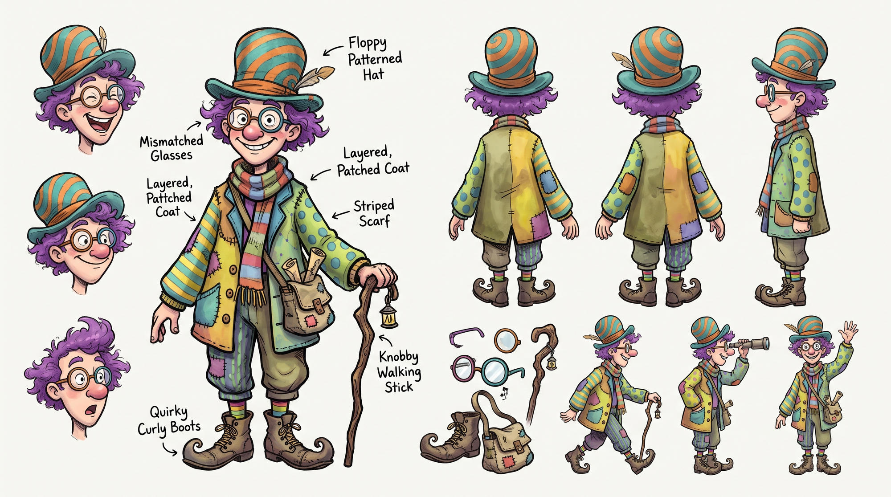

# Find Mr. Wiggles

A busy seek-and-find web game with original storybook artwork. Mr. Wiggles has wandered off again. Search a living crowd, or take your time with a dense still illustration in **Classic Mode**.

**Play:** https://thestephlab.github.io/find-mr-wiggles/



## Features

- **3D scenes**: a tilted perspective camera instead of a bird's-eye map. Upper concourses sit a storey above the halls below, escalators really climb between them, and shops, pillars, trains and planes are solid 3D objects.
- **Walk behind things, always reappear**: people pass behind kiosks, pillars and departure boards, but nobody, Mr. Wiggles included, stops anywhere the camera can't see. Routes favour open ground, so anyone who slips out of view comes back within a few seconds.
- **Living scenes**: everyone is busy doing things. They walk, jog, ride escalators and travelators, queue at check-in and security, browse kiosks, sit on benches, read the paper, play the station piano, watch the busker and wait on platforms while trains arrive and depart.
- **Detailed transport**: rounded mainline cabs, roof equipment and bogies; cream-and-teal metro coaches with sliding doors; and fictional airliners with tapered fuselages, swept wings, engine fans and landing gear.
- **Realistic people**: real-world proportions (bigger heads for children), jointed limbs with a proper walking and jogging gait, and shaded clothes, faces, hair and hats, drawn from the front, back and side.
- **Mr. Wiggles is always the same**: striped teal and orange hat with a feather, purple curly hair, mismatched glasses, a pink nose, a rainbow scarf, a patchwork coat, a satchel, striped socks, curly boots and a knobbly lantern stick. A new random seed puts him somewhere different every game.
- **Five locations**, all fictional and available in both modes:
  1. **Whistlebury Junction**, a train station with platforms, a concourse and a metro hall.
  2. **Skyhaven International**, an airport with an apron, gates, travelators, security, check-in and baggage reclaim.
  3. **Copperleaf Galleria**, with an upper shopping gallery, escalators, food court and coin fountain.
  4. **Little Lantern Market**, a village square of produce stalls, flower sellers, cafes and delivery activity.
  5. **Bramblewick Fairground**, with the moving Moonwheel, carousel, game stalls, queues and performers.
- **Classic Mode**, in Settings: five deliberately composed still panoramas with luggage mishaps, musicians, book piles, picnic groups, portraits, flower tables and toy collections. Poses, vehicles, clock faces, fountains and rides never advance. Camera controls, the search timer and hints remain responsive. All imagery is original; no published puzzle compositions or franchise characters are reproduced.
- **Five difficulty levels** (Relaxed → Expert). Higher levels give a bigger scene, a bigger crowd, more props, more of the crowd in his colours, a slower hint and a less forgiving tap. They also add more *look-alikes* who share some of his traits but never his hat and hair together.

  | Level | Crowd | Look-alikes | Max shared traits | Hint cooldown |
  | --- | --- | --- | --- | --- |
  | Relaxed | ~70 | 4% | 1 | 6 s |
  | Easy | ~150 | 12% | 1 | 9 s |
  | **Normal** | ~260 | 24% | 2 | 15 s |
  | Tricky | ~350 | 30% | 2 | 20 s |
  | Expert | ~430 | 36% | 3 | 25 s |

  Animated crowds are capped at 480, and low-powered devices get about 25% fewer moving people. Classic compositions aim for 900 / 1,450 / 2,100 / 2,800 / 3,500 people respectively, subject to safe available space, with additional narrative groups. They do not run crowd simulation.
- **Pinch to zoom and drag to pan** on touch screens. Mouse wheel, trackpad pinch and keyboard work too.
- **Progress saved locally** with `localStorage`. There are no accounts. Each mode has separate scene unlocks, completions and difficulty-specific best times. Changing mode during a search explicitly ends that search and opens a fresh start card; its timer and target are never transferred.
- **Hints, stars and wrong-guess quips**: tap the wrong person and you'll find out who they are.
- **Works offline** as an installable PWA, with self-hosted fonts and no runtime dependencies.
- **Accessible**: keyboard play with a crosshair, screen-reader announcements, native `<dialog>`s, reduced-motion support and a "calmer crowds" setting.

## Controls

| Action | Touch | Mouse / trackpad | Keyboard |
| --- | --- | --- | --- |
| Look around | Drag | Drag | Arrow keys / WASD (move crosshair at picture edges) |
| Zoom | Pinch, or the + / − buttons | Scroll wheel / pinch | `+` / `-` |
| Guess | Tap a person | Click a person | `Enter` (checks the crosshair) |
| Hint | Hint button | Hint button | `H` |
| Pause | ☰ | ☰ | `Esc` / `P` |

## Running locally

No build step and no dependencies. Requires Node 20 or later, used only for the dev server and tests.

```bash
npm start        # http://localhost:8080
npm test         # node:test unit + simulation tests
```

You can also open the folder with any static file server. ES modules need `http://`, so opening the file directly with `file://` won't work.

## Architecture

```
index.html, css/styles.css     UI shell (screens + <dialog>s), storybook patchwork theme
js/main.js                     App controller: screens, dialogs, settings, progress wiring
js/core/                       Pure, framework-free utilities (unit-tested)
  rng.js                         Seeded PRNG (mulberry32)
  storage.js                     Versioned localStorage progress with safe fallbacks
  mode.js                        Mode normalization, labels and run-setting identity
  difficulty.js                  Difficulty presets → world size, crowd, props, decoys, hints
  projection.js                  One-point perspective: world (x, y, z) → picture
  camera.js                      Pan/zoom/pinch maths
  nav.js                         Navigation graph, Dijkstra pathfinding, queues
  geometry.js                    Rect/segment helpers
js/game/
  people.js                      Character "looks"; Mr. Wiggles is a frozen look; decoy rules
  draw-person.js                 One figure model for everyone: views, gait, arm poses, far LOD
  figure/                        Figure parts: core (rig, gait, shaded limbs), head, clothes, items
  sprite-cache.js                Budgeted atlas of pre-rendered character frames
  agents.js                      Crowd behaviour state machine (travel/activity/queue/fixed)
  world.js                       Builds a world from a scene + difficulty + seed
  classic.js                     Seeded narrative composition, frozen poses, safe static target
  renderer.js                    Perspective floor cache, culling, depth sorting, sprite blits
  input.js                       Pointer Events: drag, pinch, tap, wheel, inertia
  game.js                        One play-through: loop, timer, guesses, hints, celebration
js/scenes/
  index.js                       Scene registry (order = unlock order)
  kit.js                         Scene-building API (levels, floors, 3D props, POIs, queues, escalators, occlusion)
  builders.js                    Composite builders (kiosk, bench, plant, pillar, signs…)
  draw3d.js                      3D helpers: extruded boxes, camera-facing planes, side quads
  props.js                       Reusable 3D props (benches, kiosks, pillars, escalators…)
  transport.js                   Detailed transport artwork; cached aircraft and metro bodies
  venue-props.js                 Shared facades, trees, tables, fountains and bunting
  train-station.js, airport.js   Transport locations
  galleria.js, market.js,
  fairground.js                  Shopping, village and fair locations
sw.js, manifest.webmanifest    Offline support / installable app
```

**Rendering.** The world is a ground plan (x across, y into the scene, z up). A one-point perspective camera projects it into a *picture* that you pan and zoom over. Far things shrink and converge, floors foreshorten, and people and props stand upright. The backdrop and floor are rendered once: the flat floor plan is drawn in bands and warped into perspective strip by strip (Mode 7 style). When you zoom in past that bitmap's resolution, a sharp copy of just the visible area is rebuilt once the camera settles. Props are real extruded boxes, or artwork on camera-facing planes. Everything is depth-sorted by its nearest ground line, so people walk behind and in front of things. Labels too small to read are drawn as smudges.

**Characters and smooth frame rates.** Drawing detailed figures directly is too expensive for hundreds of people every frame. Each animation frame is therefore rendered into a 1024² sprite atlas and blitted with `drawImage`. Frames are keyed by look, quantised pose (8 walk frames, 4 action frames, left mirrored from right) and scale bucket (steps of about 26%, rounded up to avoid under-resolved exact hits). Smoothness comes first:

- Preparation runs before depth-ordered drawing. People without compatible detailed coverage come first, then under-resolved sprites, then animation refinements. The least recently prepared look wins ties, so the back of the crowd cannot monopolise the budget. Mr. Wiggles and decoys use exactly the same rules.
- Each playing frame may prepare at most 4 sprites, with a target of about 5 ms. Canvas rasterisation is deferred, so counting sprites matters as much as timing them. The budget drops automatically after slow frames. One sprite may exceed the estimated time target rather than leaving large figures permanently unprepared; the count limit still applies.
- Until a sprite is ready, the closest cached scale or animation frame with the same direction, mode, action and carried item stands in. Old suitcase/action artwork cannot return after a state change. Cold starts or newly revealed people can briefly use a cheap block figure while coverage converges.
- The scene is built behind the start card, so the visible crowd is prepared before the clock starts.
- Atlas pages are recycled least-recently-used first, capped by device memory (8–20 pages).
- Tiny Animated figures (under 7 CSS pixels) and scene thumbnails intentionally use simple rendering, and very close-up figures that exceed atlas limits are drawn directly as vectors. Classic gameplay always prepares the detailed figure model at a minimum one-pixel-per-world-unit density.

**Still illustrations.** `composeClassic` arranges location-specific narrative islands and their posed participants, real seated/counter groups, and dense crossing streams. It snapshots moving transport once and fixes world/pose time, including station clocks. A spatial index checks conservative full artwork extents, including non-solid decoration, foreground arms and carried items, before choosing among reference-height-safe target placements. At least five of eight hat/head/body samples must remain visible; hit testing uses the same picture coordinates and foreground checks. The camera never changes composition or target. A new seed changes group anchors, looks and safe target selection. Classic skips `world.update` entirely. The start card shows preparation status and waits for visible full detail before enabling the search clock. After sprite/floor convergence, the game skips unchanged Canvas rendering; only camera changes, refinement and active UI overlays redraw. It retains the existing bounded floor/detail caches and atlas pages rather than allocating a full-world HiDPI bitmap. Thumbnail floors have a separate half-megapixel cap.

Frame rates depend on the device, viewport, pixel density and camera movement; headless desktop measurements are not a physical-phone guarantee. Cache counters expose rendered sprites, exact hits, compatible fallbacks, misses and coarse fallbacks (more than one scale bucket below the requested resolution) for repeatable coverage and zoom checks.

**Transport.** Mainline bodies and barrel roofs are projected in world space, with side glazing, doors, underframes and wheels. Aircraft and metro side bodies are rasterised lazily at 3 pixels per world unit and reused while moving; aircraft have separate left/right artwork to keep airline names readable. Metro door pockets and panels remain animated independently of the cached body. Scene code still owns arrival, dwell, departure, taxiing, bounds and depth ordering; edge clipping hides whole portions of metro cars rather than squeezing their windows and doors.

**Occlusion.** Solid props register picture-space occluders. `kit.visibility(x, y)` samples points over a standing person to work out how much of them the camera can see. Activity spots that would be hidden are removed. People never idle out of sight, and Mr. Wiggles always spawns in view. Path costs through hidden ground are tripled, so people only pass behind things briefly. Tests cap how long Mr. Wiggles can stay hidden.

**Crowd AI.** Each scene lays out a walkable navigation graph (grids around obstacles, plus one-way escalator and travelator links) and *points of interest* (bench seats, kiosk counters, platform edges, the departures board…). Agents pick nearby interests weighted by a "home" area, pathfind with Dijkstra, then do something there. Queues, such as check-in, security and the café, are first-come-first-served, and some even change people: checking in removes your suitcase, and baggage reclaim gives you one.

## Adding a scene

1. Create `js/scenes/my-scene.js`. World units: `x` across, `y` into the scene (0 is the far edge), `z` up. A person is about 40 units tall.

   ```js
   import { addKiosk, addBench, addPlant, scatter } from './builders.js';
   import { tiles } from './props.js';
   import { drawBox, onFront } from './draw3d.js';

   export const fairground = {
     id: 'puddleford-fair',          // unique, stable (used for saved progress)
     title: 'Puddleford Fair',       // fictional names only
     kind: 'Fairground',
     blurb: 'Candyfloss, carousels and very long queues.',
     aspect: 1.15,                   // width / depth of the ground plan
     crowdFactor: 1,                 // >1 for busier scenes
     thumbColour: '#c9476e',
     view: { topPad: 200 },          // picture space above the far edge for tall things
     build(kit) {
       const { W, H, P } = kit;      // world size (already scaled for difficulty) and the projection
       kit.defineLevel('ground', { x: 0, y: 0, w: W, h: H }, { z: 0 });  // use z > 0 for raised levels
       kit.roles = [{ role: 'tourist', weight: 3 }, { role: 'child', weight: 2 }, { role: 'elderly', weight: 0.5 }];
       kit.backdrop = (ctx) => { /* sky, back walls… drawn in picture space, cached */ };
       kit.addFloor({ x: 0, y: 0, w: W, h: H }, (ctx, view) => tiles(ctx, { x: 0, y: 0, w: W, h: H }, 48, '#8fbf6a', '#86b562', view));

       // A custom 3D prop: sorted by its nearest ground line, solid so it can hide people behind it.
       const tent = { x: W / 2 - 60, y: 300, w: 120, d: 80, h: 70, z: 0 };
       kit.addProp({
         y: tent.y + tent.d,
         box: tent,
         solid: true,
         block: { x: tent.x, y: tent.y, w: tent.w, h: tent.d },
         draw: (ctx, t, P) => {
           drawBox(ctx, P, tent, { front: '#e05a4f', top: '#f2c94c' });
           onFront(ctx, P, tent.x, tent.y + tent.d, 0, (c) => { c.fillStyle = '#fff'; c.fillRect(50, -40, 20, 40); });
         },
       });

       // Ready-made props (they register blockers, staff and activity spots)…
       addKiosk(kit, { x: 200, y: 520, name: 'Candyfloss', colour: '#ff6fb5', colour2: '#fff', goods: 'sweets', queue: true });
       scatter(kit, { x: 60, y: 60, w: W - 120, h: H - 120 }, kit.count(8), 50, 20, (x, y) => addBench(kit, { x, y: y + 16 }));
       scatter(kit, { x: 60, y: 60, w: W - 120, h: H - 120 }, kit.count(6), 24, 18, (x, y) => addPlant(kit, x + 12, y + 10));

       // …then the walkable grid last, so it routes around them.
       kit.grid({ x: 40, y: 40, w: W - 80, h: H - 80 }, 60);
     },
   };
   ```

2. Register it in `js/scenes/index.js` (array order is unlock order) and add the file to `SHELL` in `sw.js` so it works offline. Bump `VERSION` there too.
3. Run `npm test`. The scene-integrity tests automatically check every registered scene at every difficulty:
   - the nav graph is fully connected and every point of interest is reachable
   - no activity spot is hidden, and nobody idles out of sight
   - Mr. Wiggles spawns in view and always reappears from behind obstacles
   - the crowd keeps moving and people use escalators where the location has multiple levels

4. Add a location-specific entry to `STORIES` in `js/game/classic.js`, reuse or extend its original illustrated tableaux, and use meaningful scene POIs for static activity groups. Draw scenery from the supplied time, never `Date.now()` or fresh randomness during rendering; use `kit.clock` for clock faces. Dynamic objects must support a stable `parts()` snapshot or a draw function receiving fixed time. Classic tests cover every difficulty and replay seeds, full pose/world stillness, decoy rules and safe click targets. Inspect complete compositions and close-ups as well as running tests; counts alone do not establish visual quality.

Useful kit APIs: `addProp` (3D, with `solid` occluders), `addDynamic` (animated things: `draw` underlays or depth-sorted `parts()`, like trains), `poi`, `queue`, `gateQueue` (queue-gated one-way passage), `escalator` (climbs between levels), `travelator`, `station` (stationary staff), `zAt(x, y)`, `visibility(x, y)`, `count(n)` (scales with difficulty) and `isFree(rect)`.
## Progress & privacy

Everything is stored under one `localStorage` key (`find-mr-wiggles:progress`) on your device. Nothing is sent anywhere. Schema v2 stores `settings.mode` and separate `modes.animated.scenes` / `modes.classic.scenes` records. Original v1 saves migrate losslessly into Animated, which remains the default; Classic starts its own station-first sequence. Migration is persisted with the next settings/result write. Corrupt or unavailable storage, such as in private browsing, falls back safely to in-memory play. Settings → *Reset progress* clears both histories but retains preferences.

## Credits

- Mr. Wiggles character design: the original character sheet in `assets/`.
- Fonts: [Grandstander](https://fonts.google.com/specimen/Grandstander) and [Atkinson Hyperlegible](https://fonts.google.com/specimen/Atkinson+Hyperlegible), both under the SIL Open Font License and self-hosted for offline play.
- All places, airlines and destinations are fictional.
